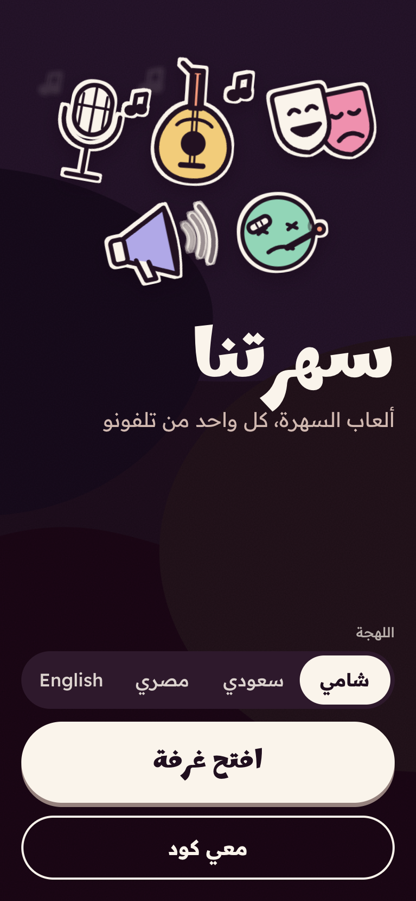
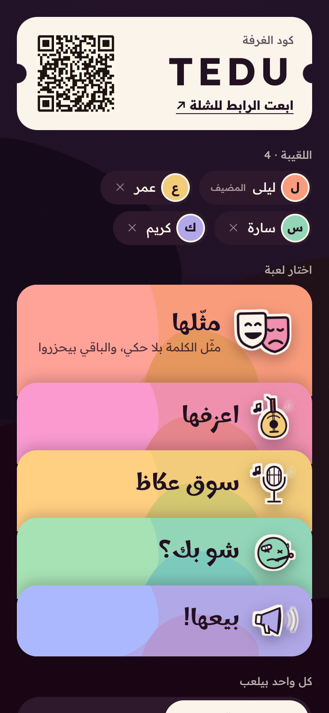
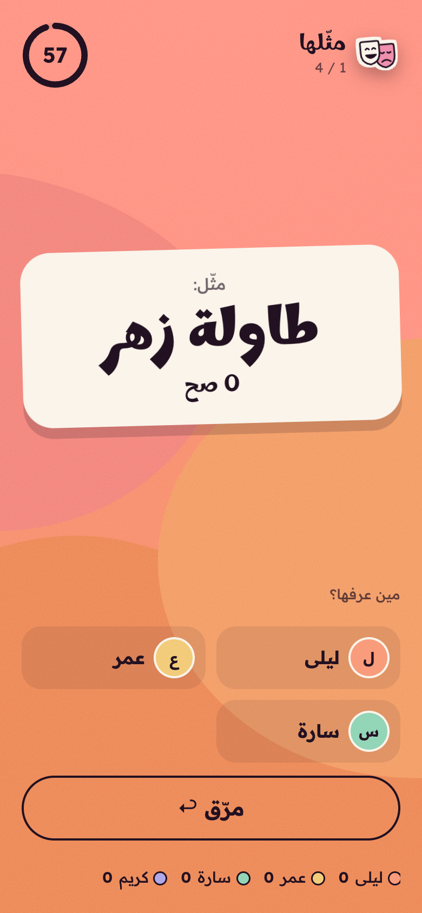
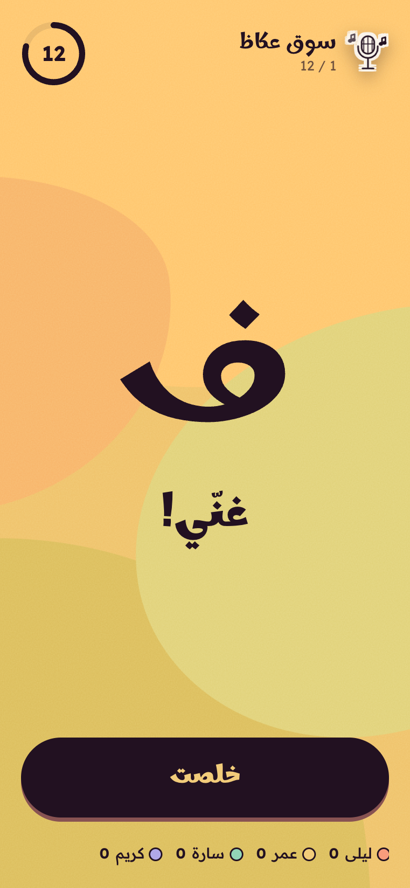
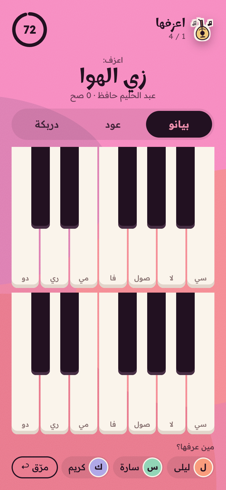
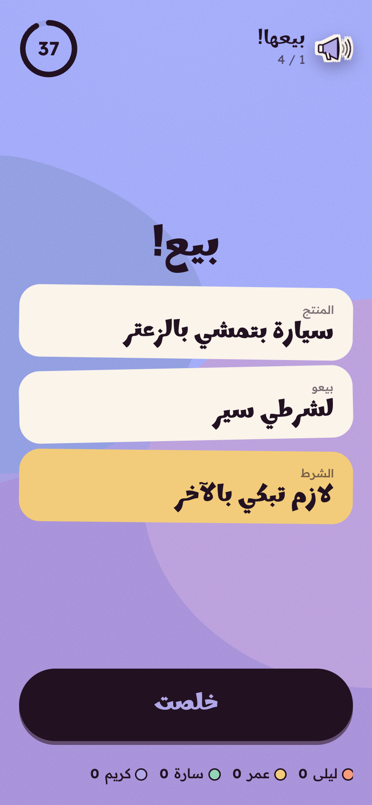

# Sahretna (سهرتنا)

**Arabic party games for a room of friends, played on your phones.** One person opens a room, everyone else joins with a code, a QR or a shared link, and each phone shows that player what they need: the secret word, the instrument, the vote.

  
  
  

  
  
  

**Live:** [sahretna-production.up.railway.app](https://sahretna-production.up.railway.app) (free, no sign-up, works in any phone browser)

## The games
- **مثّلها (charades):** act out the word without talking while the others guess
- **سوق عكاظ (song chain):** sing a song, and its last letter starts the next one
- **شو بك؟ (the sick visit):** one player is sick and can't talk; the visitors ask questions and guess what's wrong
- **بيعها! (sell it):** 40 seconds to pitch a strange product, then everyone rates the pitch
- **اعزفها (play it):** play the song on a piano, an oud with maqam tuning, or a derbake, and the others name it

## What it does
- Four languages: شامي, سعودي, مصري and English. Each dialect has its own cards and songs, and English switches the layout to left to right
- Up to 12 players in a room, with scores kept across games
- Secret cards reach only the phone that should see them
- Instruments play live in the browser, so there is nothing to install

## Built with
Node.js, WebSockets, plain JavaScript, Web Audio. Hosted on Railway.

## About this repo
The source code is private. This page describes the game and links to it.

Built by [Hiba Hassan](https://github.com/hibashassan).
